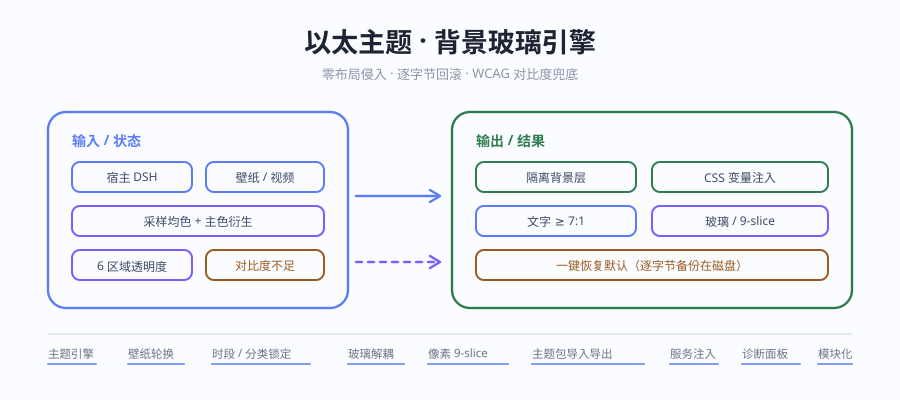

# dsh-aether-theme · 以太主题

> 给 [DeepSeek Harness](https://deepseek.com) 桌面版的背景 + 毛玻璃外观引擎。
> 零布局侵入、逐字节回滚、模块化按需加载；WCAG 动态对比度兜底、智能色彩衍生、
> 壁纸轮换与时段切换、主题包导入导出、屏幕内诊断面板。



## 特性

- **零布局侵入**：不新增/移动/删除宿主 DOM。只做两件事——一个 `z-index:-1` 的隔离舞台层，和一套 CSS 变量覆盖。
- **逐字节回滚**：每次保存配置前先把旧版本原样备份到磁盘（保留 20 份）；「一键恢复默认」先备份再写默认值。
- **模块化**：主题引擎 / 壁纸 / 玻璃 / 像素 / 诊断 / 渐变边框 / 粒子小鱼七个模块（余额挂件与开屏已拆成独立插件），各自可 `disabled`，关掉的模块不渲染不注入。
- **WCAG 对比度兜底**：所有文字色都由「有效背景色（面板半透明叠在壁纸上）」反解，目标 7:1；达不到就把面板不透明度往 1 推，直到达标。
- **智能色彩衍生**：壁纸缩小到 48×48 采样，取平均亮度与主色，衍生主色/辅助色/三档色阶。
- **防闪烁过渡**：壁纸双缓冲——旧层保持、新层淡入，过渡结束才移除旧层。
- **参数解耦**：毛玻璃模糊与背景模糊分离；6 个区域独立透明度；输入框 6 种填充模式。
- **动态壁纸生态**：自动轮换、白天/夜晚时段切换、轮换范围分类锁定。
- **像素风**：四套像素主题 + 9-slice 贴图边框 + CRT 扫描线（零图片文件，全部内联 SVG/CSS）。
- **生态开放**：主题包 JSON 导入导出；`aetherTheme` 服务注入，其他插件可注册自己的主题。
- **诊断友好**：屏幕内诊断浮层 + `diag.json` 导出；宿主 DOM 契约金丝雀——任一关键锚点（`#root` / `body` / `html[data-platform]`）连续 40 次缺失就撤离注入、交还原生布局。

## 安装

```bash
# 从本仓库安装（源码）
dsh plugin --profile desktop add github:feiyu-whale-05/dsh-aether-theme

# 或本地目录（开发）
dsh plugin --profile desktop add D:/DSH-plugins/dsh-aether-theme
```

安装后重启 DSH。左侧栏「以太主题」是控制台；设置页「以太主题」是快速项。

## 组合包

这是一个**组合包**：

| 伙伴 | 许可 | 职责 |
|---|---|---|
| [dsh-cost-meter](https://github.com/Han-1413141/dsh-cost-meter) | MIT | 会话成本 / 余额 / 峰谷价提醒（本插件不再自带简陋余额挂件） |
| `dsh-boot-splash-pro` | BSD-3-Clause | 片头动画（首帧注入，官方加载卡片不再露脸；本插件不再自带开屏） |

- 本插件 `dependencies` 声明了 `dsh-cost-meter`，`cordis.patch.yml` 额外 insert 一行加载它
- 如果你的 profile 已经单独装过 dsh-cost-meter（`bundles` 里有它），**删掉**本插件 patch 里的「组合包」段，否则会注册两次
- 只想用主题、不想带费用条：同样删掉那段即可

## 目录

```
lib/      Host 侧：配置原子写、壁纸库（流式上传 + Range 回放）、诊断
src/      Client 源码（按文件名拼接，见 src/build.js）
client.js 构建产物（单文件浏览器 bundle）
locale/   meta.title / meta.description（中文名与简介）
docs/zh.md 插件页介绍（meta.detail）
assets/preview.svg 介绍大图
```

## 开发

```bash
npm run build      # 重新拼接 client.js
npm test           # Host 侧单元测试（store / wallpapers / 10 条路由鉴权 / 上传失败路径）
npm run check      # 静态体检：CSS 结构与 12 条回归红线、React Hooks 纪律、版本一致性、客户端 vm 冒烟
npm run smoke      # 槽位注册 + 路由注册冒烟
npm run verify     # 上面四件套一次跑完
```

### 性能基线（v1.2.0 起）

按《性能优化报告》逐项落地，并新增「让插件自己上报实测值」的探针——
桌面版跑在 `dsh-app://` 自定义协议下没有 CDP 端口可连，`/api/diag.json` 里的
`effects.layout` / `effects.mediaProbe` 就是唯一可信的现场数据来源。

| 项 | 改动 | 现场实测 |
|---|---|---|
| 壁纸每帧全屏 filter | 去掉 `filter: brightness()`；压暗改由 veil 的黑色遮罩承担（`brightness<1` 时视觉等价，提亮才保留 filter） | `media.filter: none`（原 `brightness(0.85)`，全屏） |
| 全屏 blend 空转 | veil 无贡献（alpha≈0）时不再创建元素；混合模式只在 veil 可见时生效 | 原 `veil: multiply + rgba(0,0,0,0)`，纯浪费 |
| 失焦/不可见暂停 | 视频解码、小生物 CSS 动画、鲸鱼、流星整体挂起 | `critters.animation.playState: paused`（窗口失焦时） |
| 流星渐变分配 | 按 (hue,size) 预渲染 sprite + `drawImage`，不再每粒子每帧 `createRadialGradient` | 消除每帧数十次渐变对象分配 |
| 壁纸滑杆 | 亮度/压暗只改变量，不再每次 `applyWallpaper`（避免重复取色 + syncFx + syncWhale + 二次通知） | — |
| 全屏磨砂保险丝 | 若 `[data-aether-frame]` 面积 > 60% 视口且带 blur，自动撤掉磨砂并记日志 | 实测该元素是 **0×0**，当前无全屏 blur 成本 |

顺带修掉一个真 bug：桌面版首帧时媒体令牌还没到，旧的 `mediaUrl()` 会回落到把
**页面令牌塞进 query**，而 Host 只认 header/媒体令牌 → 401 → `<video>` 报
`DEMUXER_ERROR_COULD_NOT_OPEN`，**视频壁纸静默降级成 CSS 背景**。
现在不再回落页面令牌，并在媒体令牌到位后重建壁纸层。

### 审查基线（v1.1.0 起）

`npm run check` 里的两道门是必须过的，它们对应历史线上事故：

- `scripts/check-css.mjs`：花括号必须平衡、普通规则里不能嵌规则（CSS Nesting 下永不匹配）、同选择器同自定义属性不能重复声明；另外 12 条红线覆盖「遮罩变量被吞」「分区底色被 chrome-fill 覆盖」「气泡被钉成浅蓝」「侧栏 backdrop-filter/transform 创建包含块」等。
- `scripts/check-hooks.mjs`：任何含 hook 的函数必须通过 `h()` 挂载或原样交给 `slots.register()`，禁止在别的组件渲染期当普通函数调用。
- `scripts/check-version.mjs`：`src` / `client.js` / `package.json` 版本必须一致，Host 侧一律从 `package.json` 读版本。

## 许可

MIT License。代码可商用。仓库不含第三方主题素材：壁纸由用户自行提供，内置背景全部由 CSS 绘制。

## 致谢 / 灵感来源

- 海洋小生物、气泡、浮游生物的呈现方式，以及鱼的**品牌剪影路径**（DeepSeek Figma 提取，品牌素材）参考了 [WYH66666666/DSH-Transparent-UI-Plugin](https://github.com/WYH66666666/DSH-Transparent-UI-Plugin)（dsh-client-ui-aqua，AGPL-3.0）：同样是「固定透明容器 + 内联 SVG + CSS keyframes」方案；本插件的 SVG 图形路径与代码为独立编写，未复制上游源码（避免 AGPL 传染到 MIT 项目）。
- 输入框渐变边框的交互与配色参考 wenxin.baidu.com 的聚焦态设计。
- 壁纸/玻璃/对比度方案的设计取舍参考了社区里 DSH-UI-Beautify、dsh-pixel-ui、dsh-ui-appearance、dsh-luna-theme、dsh-theme-gallery 等插件的公开实现思路。
