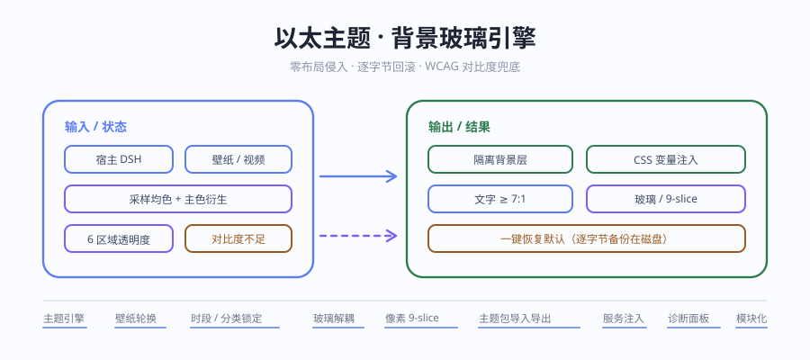

# 以太主题（dsh-aether-theme）

给 DSH 桌面版一层「背景 + 毛玻璃」的外观引擎：换背景、调玻璃、自动兜底文字对比度。
**零布局侵入、逐字节回滚、模块化按需加载。**

## 它解决什么问题

主题插件最怕两件事：把宿主布局改坏、换完背景字看不清。以太主题的取舍是——
只动 CSS 变量与一个隔离背景层，**不新增/移动/删除宿主的 DOM 结构**；
所有文字颜色都经过 WCAG 对比度反解，达不到目标就自动提高面板不透明度兜底。

## 功能

| 分类 | 能力 |
|---|---|
| 架构 | 隔离节点 + CSS 变量注入；配置原子写盘且每次写前备份（最多 20 份）；模块可单独 `disabled` |
| 无障碍 | WCAG 动态反解（主文字/次级文字 ≥ 7:1，弱化文字 ≥ 4.5:1）；全量适配 `prefers-reduced-motion` |
| 智能取色 | 壁纸采样平均亮度 + 主色，衍生主色/辅助色/三档色阶；切换壁纸自动重算 |
| 渲染 | 壁纸双缓冲淡入淡出（防白闪/黑闪）；视频壁纸原生流式硬解、静音循环；纯 CSS 动态预设零图片 |
| 参数 | 毛玻璃（glassBlur）与背景模糊（backgroundBlur）解耦；6 区域独立透明度；输入框 6 种填充模式 |
| 壁纸生态 | 自动轮换、按时间段（白天/夜晚）切换、轮换范围分类锁定 |
| 像素风 | 四套像素主题；9-slice 贴图边框（不同分辨率四角不变形）；可选 CRT 扫描线 |
| 生态 | 主题包 JSON 导入导出；服务注入（其他插件可注册主题）；内置诊断面板 + `diag.json` 导出 |

## 安装

桌面版：设置 → 插件 → 添加插件，填入本仓库地址；或本地目录：

```bash
dsh plugin --profile desktop add D:/DSH-plugins/dsh-aether-theme
```

装好后重启 DSH，左侧栏出现「以太主题」，设置页出现同名分区。

## 使用

1. 左侧「以太主题」→ 壁纸：选纯 CSS 预设，或上传图片/视频。
2. 玻璃：先调「背景模糊」，再调「玻璃模糊」；6 个区域各自独立。
3. 对比度：默认 7:1。如果壁纸太花，算法会自动把面板往不透明推——这是兜底，不是 bug。
4. 主题包：导出 JSON 分享，或导入别人的包。
5. 诊断：金丝雀计数、锚点状态、导出 `diag.json`。

## 架构

```
Host（Node）                        Client（浏览器 bundle）
├─ 配置原子写 + 快照备份            ├─ 隔离背景层 #dsh-aether-stage（z-index:-1）
├─ 壁纸库（流式上传 / Range 回放）  ├─ CSS 变量投影（--aether-* → --dsw-*）
├─ 页面令牌注入                     ├─ WCAG 反解 + 兜底
└─ 诊断聚合 / diag.json             ├─ 官方槽位：sidebar.panellist / main / settings.section / shell.overlay
                                    └─ 金丝雀：锚点全丢 40 次 → 撤离注入
```

## 许可

MIT。代码可商用；**不含任何第三方主题素材**，壁纸由用户自行提供或使用内置纯 CSS 预设。
